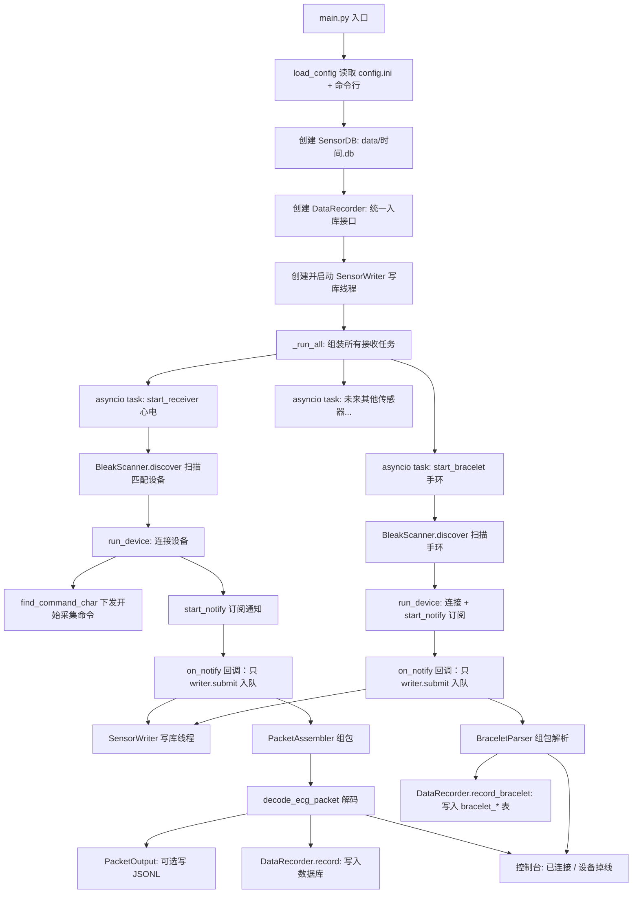

# 蓝牙心电数据接收与存储项目 —— 开发思路文档

> 本文档面向后续接手的开发人员 / AI 智能体，说明代码结构、功能原理、设计思路与注意事项，
> 目标是让阅读者能在不破坏现有功能的前提下，正确完成功能的新增与修改。

---

## 1. 项目概述

本项目从蓝牙心电设备（BLE 外设）接收 244 字节的心电数据包，解码出
**心电（ECG）/ 呼吸 / 三轴加速度 / 体温** 四类数据，并同时完成：

- 控制台**只打印「连接成功 / 设备掉线」两类日志**（不打印采集数据，避免刷屏与阻塞）；
- 可选写入 JSONL 文件；
- 写入 SQLite 数据库（`data/` 目录下，按当前系统时间命名的 `.db` 文件）。

同时接入**绿光手环**（另一台 BLE 设备），接收 **4 通道 PPG / 腕部三轴加速度 / 皮电(GSR) /
肤温 / 电量** 数据，与心电数据写入**同一个数据库文件的不同表**（`bracelet_*`），
以 `devices/bracelet_protocol.py` 的协议解析为参考实现。

项目是 Windows 11 移植版，底层 BLE 库为 `bleak`（WinRT 后端），
替代原 Linux 版 `app_collect.py` 中仅支持 Linux 的 `bluepy`。

### 核心设计原则

1. **单入口**：`main.py` 是唯一入口，运行一次即可启动所有传感器（心电 + 手环）的接收与存储流程。
2. **存储为核心**：所有传感器数据统一写入同一个数据库，由 `core/db_storage.py` 提供统一接口。
3. **接收模块可插拔**：每个传感器对应一个接收模块，对外暴露
   `async def start_xxx(recorder, ...)` 协程，在 `main.py` 的任务列表中注册即可。

---

## 2. 文件结构

> **2026-10-24 结构调整**：代码已按 `core / devices / ui / tools / docs` 分层，
> 模块名见下表。逐行对照与改造原因见 `docs/重构说明.md`，数据流见 `docs/架构说明.md`。

```
AAAwindows_code/
├── main.py                 # 采集入口：读配置、初始化存储、启动所有接收任务
├── run_monitor.py          # 采集 + 界面入口：同一套接收模块，外面套 PyQt5 界面
├── config.ini              # 默认配置（设备名、扫描时长、输出文件、批量提交等）
├── requirements.txt        # 依赖：bleak>=0.21.0（实际环境安装 3.0.2，见注意点）、PyQt5、pyqtgraph
├── README.md               # 面向使用者的说明文档
├── core/                   # ---- 核心层（不依赖设备与界面）----
│   ├── config.py           #   config.ini → 强类型 Config（唯一读取入口）
│   ├── db_storage.py       #   SensorDB（建库建表）+ DataRecorder（统一入库接口）
│   ├── writer_thread.py    #   写库线程：通知回调只入队，解析/入库在独立线程执行
│   └── device_status.py    #   线程安全的设备状态表（BLE 线程写、界面线程读）
├── devices/                # ---- 设备层 ----
│   ├── ecg_receiver.py     #   心电：扫描/连接/握手/解码/输出，暴露 start_receiver
│   ├── bracelet_protocol.py#   手环协议解析（纯字节 → 数据类，无蓝牙依赖）
│   ├── bracelet_receiver.py#   手环：扫描/连接/订阅，暴露 start_bracelet
│   ├── camera_receiver.py  #   USB 摄像头：按目标帧率截帧入库
│   ├── ble_utils.py        #   BLE 公共工具：服务表打印 / 按名扫描
│   └── legacy_bracelet.py  #   手环协议独立调试脚本（主程序不引用）
├── ui/                     # ---- 界面层 ----
│   ├── buffers.py          #   实时缓冲 + MonitorRecorder（入库钩子）
│   ├── replay.py           #   历史库 / JSONL 回放
│   ├── window.py           #   主窗口：设备准备 / 心电 / 手环 / 摄像头 / 状态
│   ├── widgets.py          #   卡片、图表、导航等组件
│   └── theme.py            #   配色与全局 QSS
├── tools/                  # ---- 排障与自检 ----
│   ├── ble/                #   扫描、扫描重试策略验证
│   ├── camera/             #   摄像头枚举、帧导出
│   ├── db/                 #   库概览、合并、回放检查、同库验证
│   └── ui_screenshot.py    #   离屏截图 + 界面冒烟断言
├── docs/                   #   架构说明 / 重构说明 / 绿光手环数据协议.docx
├── data/                   #   运行时自动创建，存放按时间命名的 .db
├── ecg_data.jsonl          #   运行时生成（可选）的 JSONL 输出
└── ui_shots/               #   界面截图
```

> 注意：`app_collect.py`、`bluepy/`、`com/` 等位于**上级目录** `data_aggregation_1/`，
> 是原 Linux 版代码，不在本项目目录内，仅作协议参考。

---

## 3. 架构与数据流



**数据流一句话**：`main.py` 启动任务 → 两个接收模块各自扫描/连接；通知回调**只把原始字节入队**
给写库线程 → 写库线程里解析/解码/入库/落盘 → 写入 `data/` 下**同一个** SQLite 数据库（心电表 + 手环表）；
控制台只输出「已连接并开始接收」「设备已掉线」两类日志。

---

## 4. 模块详解

### 4.1 `main.py` —— 采集入口

**职责**：读取配置、初始化存储、组装并运行所有接收任务。

关键函数：

| 函数 | 作用 |
| --- | --- |
| `load_config()` | 解析命令行参数 + `config.ini`，返回配置 dict（含 `PacketOutput` 实例） |
| `_run_all(cfg, recorder)` | **所有接收任务的注册点**，`asyncio.gather` 统一运行 |
| `main()` | 创建 `SensorDB` + `DataRecorder`，`asyncio.run` 运行，`finally` 关闭数据库 |

**新增传感器的接入点**就在 `_run_all()` 的 `tasks` 列表里，见第 8 节。

配置项说明（来自 `load_config`）：

| 键 | 含义 |
| --- | --- |
| `device_names` | 目标设备广播名称列表（逗号分隔，过滤后） |
| `scan_timeout` | 扫描时长（秒） |
| `debug` | 连接后是否打印服务/特征表 |
| `output` | `PacketOutput` 实例（只负责可选 JSONL 文件写入，不打印数据） |
| `bracelet` | 手环配置 dict：`names` / `scan_timeout` / `notify_uuid` / `start_delay` / `reconnect_interval` / `rescan_interval` / `debug`；`names` 为空则跳过手环任务 |
| `storage` | 存储配置 dict：`commit_interval`（秒）/ `commit_rows`（行）/ `flush_interval`（秒，写库线程强制提交周期） |

### 4.2 `core/db_storage.py` —— 存储核心

#### `SensorDB` 类

- `__init__(data_dir="data", db_name=None)`：建目录，按 `%Y%m%d_%H%M%S.db` 命名；
  同名文件自动加 `_01`、`_02` 后缀避免覆盖；连接 SQLite 并开启 WAL。
- `insert(table, value, ts=None)`：单条写入（**不立即 commit**，按阈值批量提交）。
- `insert_many(table, values, ts=None)`：批量写入（ECG 一包 80 点一次写入，共享同一时间戳）。
- `commit()`：显式提交；`_maybe_commit()`：累计 ≥ `commit_rows` 行或距上次提交 ≥ `commit_interval` 秒时提交。
- `close()`：提交并关闭连接。

**表结构统一为**：`(time TEXT, value TEXT)`，`value` 对复杂结构做 JSON 序列化，
因此新传感器**无需预定义表结构**，写入时自动 `CREATE TABLE IF NOT EXISTS`。

#### `DataRecorder` 类

统一的传感器数据入库接口，所有接收模块都通过它写入数据库：

- `store(table, values, ts=None)`：通用写入，`values` 为标量或标量/dict 列表。
- `record(decoded, ts=None)`：按解码结果的类型字段分流到不同表（心电专用）。
- `record_bracelet(decoded, ts=None)`：手环专用分流（`bracelet_*` 表，见 4.4 节）。
- 底部留有 `store_xxx` 示例注释，供新增传感器参考。

当前表与数据类型映射（心电；手环表见 4.4 / 第 6 节）：

| 表名 | 数据 | value 示例 |
| --- | --- | --- |
| `ecg_data` | 心电采样点（每点一行） | `3` |
| `temperature_data` | 体温 | `36.5` |
| `breath_data` | 呼吸采样点（每点一行） | `12` |
| `triaxial_data` | 三轴点（JSON） | `{"x":0.1,"y":0.2,"z":-0.98}` |

### 4.3 `devices/ecg_receiver.py` —— 心电接收模块

**对外接口**：`start_receiver(recorder, device_names, scan_timeout, output, debug)`

内部结构（自上而下）：

1. **协议常量**（见第 5 节）
2. `decode_ecg_packet(data)`：解码 244 字节数据包，返回 dict 或 `None`
3. `PacketAssembler`：字节流缓冲重组（应对 MTU 分包/粘包）
4. `PacketOutput`：可选 JSONL 文件写入（**不再向控制台打印采集数据**）
5. `find_notify_char(client)`：定位通知特征
6. `dump_services(client)`：打印服务/特征表（排查用）
7. `find_command_char(client)`：定位命令特征（下发开始/结束采集）
8. `run_device(device, output, debug, recorder)`：单设备连接循环（含断线重连）
9. `start_receiver(...)`：扫描匹配设备并启动 `run_device` 任务

**关键流程（`run_device`）**：

1. `client.connect()` 连接；
2. 可选 `dump_services`；
3. `find_notify_char` 找通知特征；
4. 握手：写 handle 20/25（遗留 CCCD 使能，失败可忽略）→ 写命令特征下发“结束采集 + 开始采集”；
5. `start_notify` 订阅，`on_notify` 回调里组包 → 解码 → `output.emit` + `recorder.record`；
6. 保持连接，断开后 3 秒重连。

### 4.4 `devices/bracelet_receiver.py` —— 绿光手环接收模块

**对外接口**：`start_bracelet(recorder, device_names, scan_timeout, debug, notify_uuid, start_delay, reconnect_interval, rescan_interval)`

内部结构：

1. `PPGPacketData`：整包 PPG 结果（4 通道 × 10 采样点 + 1 组腕部三轴）；
2. `BraceletParser(ProtocolParser)`：复用 `bracelet_protocol.py` 的解析器，**仅重写 `_parse_ppg_accel`**，
   把 PPG 载荷（160 字节 = 10 采样点 × 4 通道 × 4 字节）解析为全部 10 个采样点
   （原实现只取每通道第 1 个采样点）；GSR / 肤温 / 电量仍用父类逻辑；
3. `dump_services`：`--debug` 时打印服务/特征表；
4. `BraceletReceiver`：`scan()` 扫描匹配、`find_notify_char()` 定位通知特征、
   `run_device()` 单设备连接循环（含断线重连）、`_on_ppg/_on_gsr/_on_temp/_on_battery` 写库回调；
5. `start_bracelet(...)`：顶层循环——扫描失败按 `rescan_interval` 重扫，扫到后交给 `run_device`。

**关键流程（`run_device`）**：

1. 连接（`BleakClient(device)`）；
2. 可选 `dump_services`；
3. `find_notify_char`：指定 `notify_uuid` → 常见透传 UUID（`bracelet_protocol.COMMON_NOTIFY_UUIDS`）→
   任意 `notify/indicate` 特征；
4. **无需下发采集命令**，直接 `start_notify` 订阅（协议文档只定义上行数据）；
5. 回调里 `parser.feed(bytes(data))` 组包解析 → `recorder.record_bracelet(...)` 入库；
6. 断开后按 `reconnect_interval` 重连（重连时清空半包缓冲）。

**控制台输出策略（两个模块统一）**：只打印两类日志——
`[设备] 已连接并开始接收 (...)` 与 `[设备] 设备已掉线，N 秒后重连...`；
扫描过程、设备列表、逐包数据、统计信息一律不打印。仅以下情况例外：
`--debug`（打印服务/特征表）、异常（`连接异常` / `扫描失败` / 写库线程出错 / JSONL 写文件失败）。

### 4.5 `core/writer_thread.py` —— 写库线程（关键性能组件）

**对外接口**：

| 成员 | 作用 |
| --- | --- |
| `SensorWriter(recorder, flush_interval=0.5, max_queue=20000)` | 构造（`recorder` 为 `DataRecorder`） |
| `start()` / `stop()` | 启动/停止后台线程（`stop` 会先排空队列再提交事务） |
| `submit(fn)` | **非阻塞**入队一个零参可调用对象；队列满时丢弃最旧任务并计入 `stats["dropped"]` |
| `flush()` | 立即提交事务 |
| `stats_line()` | 一行统计（入队/完成/丢弃/出错/积压峰值），供排查/日志使用（默认不打印） |

**为什么必须有它**：Windows(bleak/WinRT) 下若在通知回调（事件循环线程）里做 SQLite 写入、JSONL 落盘、
打印等耗时操作，事件循环会被周期性阻塞，**WinRT 侧的 BLE 通知缓冲会溢出并整条丢弃**——
表现为"采样率只有标称的一半左右"，且同一特征上的各类帧（PPG/GSR/肤温）**按同一比例**一起掉。

**两个接收模块的用法**（模式完全一致）：

```python
def process(payload):            # 重活：解析 + 入库 + 落盘
    parser.feed(payload)

def on_notify(_sender, data):    # 回调内只做字节拷贝 + 入队
    payload = bytes(data)
    writer.submit(lambda: process(payload))
```

> 约定：**新增接收模块时，通知回调里只允许 `bytes(data)` + `writer.submit(...)`**，
> 任何解析/入库/IO 都必须放进提交的任务里。`writer=None` 时模块退化为"回调内直接处理"
> （单测/离线调试可用，正式采集务必传入 writer）。

---

## 5. 数据协议（244 字节数据包）

包头 `0x5B`，包尾 `0x5D`，总长 244 字节。

| 偏移 | 字段 | 说明 |
| --- | --- | --- |
| 0 | 包头 `0x5B` | |
| 1 | 指令类型 | |
| 2 | 包长度 | |
| 3 | 未知 | |
| 4:8 | 包号 | uint32 大端 |
| 8 | 类型字1 `0x01` | ECG |
| 9 | 类型1长度 | |
| 10 | loff | |
| 11:13 | 体温 | int16 小端 / 100.0 |
| 13:173 | 80 个 ECG 采样点 | int16 小端，有符号 |
| 173 | 类型字2 `0x03` | 呼吸 |
| 174 | 类型2长度 | |
| 175:191 | 8 个呼吸采样点 | int16 小端，有符号 |
| 191 | 类型字3 `0x02` | 三轴 |
| 192 | 类型3长度 | 字节数，÷3 为采样点数 |
| 193:209 | x 轴 | int8 / 64.0 |
| 209:225 | y 轴 | int8 / 64.0 |
| 225:241 | z 轴 | int8 / 64.0 |
| 241:243 | CRC16 | |
| 243 | 包尾 `0x5D` | |

解码结果 dict 形如：

```python
{
    "ECG": {"体温": 36.5, "ECG": [1024, 1025, ...]},
    "呼吸": [100, 101, ...],
    "三轴": [{"x": 0.0, "y": 0.0, "z": 1.0}, ...],
    "_包号": 12345,
    "_CRC16": "1A2B",
}
```

> 该协议完全对齐原 Linux 版 `app_collect.py` 中 `NotifyDelegate.dec()` 的十六进制偏移
> （原代码 hexlify 后索引 ×2，本代码直接按原始字节用 `struct` 解析）。

### 5.1 手环数据帧（绿光手环，来自《绿光手环数据协议》）

公共帧头 `00 AA 00 CC` + 设备 ID 4 字节（小端）+ 数据类型 1 字节，之后按类型区分：

| 类型 | 含义 | 载荷结构 | 频率 |
| --- | --- | --- | --- |
| `0x30` | 4 通道绿光 PPG + 腕部三轴 | 计数戳 2 字节 + PPG 160 字节 + 三轴 6 字节（总 177） | 40ms/包 |
| `0x21` | 皮电 GSR | 20 字节（每 2 字节一个电导样本，共 10 个） | 1s/包 |
| `0x33` | 肤温 | 温度 2 字节 + 空 1 字节（总 12） | 10s 更新 |
| `0x34` | 电量 | ADC 2 字节（总 11） | 不定 |

**PPG 载荷要点**（`BraceletParser._parse_ppg_accel`）：160 字节按 **16 字节一组**共 10 组，
每组 = 4 通道各 4 字节（第 1 字节为状态位 `00/08/10/18`，忽略；后 3 字节为 24bit 有符号数据）。
即 **1 个采样点 = 4 通道同时间点**，40ms 一包 → 每通道 250sps。
公式：`data = sign_extend24(b[0]<<16 | b[1]<<8 | b[2])`（等价文档的 `/256` 写法）。

三轴：每轴 2 字节 int16 大端，`x = data * 32 / 65535.0`（g）。

> 该协议解析**复用 `bracelet_protocol.py`**（`ProtocolParser` 及其 GSR/肤温/电量解析），
> 本模块只扩展了 PPG 的整包解析，故协议若有变动应优先改 `devices/bracelet_protocol.py`。

---

## 6. 数据库设计

- 位置：`data/` 目录（相对于运行目录），文件名如 `20260903_183000.db`。
- 引擎：SQLite，WAL 模式。
- 每张表两列：`time`（当前系统时间字符串）、`value`（JSON 字符串或原始字符串）。
- 每个数据包收到时，该包内所有采样点共享同一个时间戳（`datetime.now()`）。
- 数据库在程序启动时创建一次，`main()` 的 `finally` 中关闭。
- **心电与手环共用同一个数据库文件**，各自写入不同表（表名见下）。

| 表名 | 对应设备 | 数据 | value 示例 |
| --- | --- | --- | --- |
| `ecg_data` | 心电贴 | 心电采样点（每点一行） | `3` |
| `temperature_data` | 心电贴 | 体温 | `36.5` |
| `breath_data` | 心电贴 | 呼吸采样点（每点一行） | `12` |
| `triaxial_data` | 心电贴 | 三轴点（JSON） | `{"x":0.1,"y":0.2,"z":-0.98}` |
| `bracelet_ppg_data` | 手环 | 4 通道 PPG（每采样点一行） | `{"PPG1":1024,"PPG2":1031,"PPG3":998,"PPG4":1007}` |
| `bracelet_accel_data` | 手环 | 腕部三轴（每包一行） | `{"x":0.01,"y":-0.02,"z":-0.98}` |
| `bracelet_gsr_data` | 手环 | 皮电电导（每样本一行） | `61.8` |
| `bracelet_skin_temp` | 手环 | 肤温（标量，℃） | `33.5` |
| `bracelet_battery` | 手环 | 电量（JSON） | `{"adc":2516,"percent":94.4}` |

> 表名常量定义在 `core/db_storage.py` 顶部（`BRACELET_*_TABLE`），分流规则在
> `DataRecorder.record_bracelet`；新增手环类型数据时改这两处即可。

---

## 7. 关键注意点（踩坑记录）

> 这些是实测踩过的坑，后续修改务必遵守，避免回归。

1. **bleak 版本差异（重要）**：`requirements.txt` 写的是 `bleak>=0.21.0`，但实际环境
   安装的是 **`bleak 3.0.2`**。其 API 与旧版不同：
   - `BleakScanner.discover(..., return_adv=True)` 返回
     `dict[str, tuple[BLEDevice, AdvertisementData]]`（键是地址字符串，值是 `(设备, 广播数据)` 元组），
     因此必须用 `for dev, adv in found.values()` 遍历，**不能用 `for dev, adv in found`**。
   - `write_gatt_char` 只能按**特征**解析（int handle / UUID / 特征对象），
     不能像 bluepy 那样直接写任意属性句柄（如 CCCD 描述符）。

2. **硬编码句柄 20/25/22 失效**：原 Linux 代码用 bluepy 硬编码句柄
   `20`、`25`（写 `0x0100` 使能通知，实为 CCCD 描述符）和 `22`（下发开始/结束采集命令）。
   在 Windows/bleak 下：
   - 写 20/25 会报 `Characteristic ... was not found!` —— **可安全忽略**，
     因为 `bleak` 的 `start_notify` 已自动写 CCCD，这两步是 bluepy 时代的遗留操作。
   - 写 22（命令特征）才是必需的，但该设备在 Windows 下句柄不一致，
     因此引入 `find_command_char()` 动态解析：优先原句柄 22，失败则在目标服务
     `554b0001-15e1-4af1-a6e3-588089f20b68` 内查找带 `write` 属性的特征。

3. **设备 UUID**：目标服务 UUID = `554b0001-15e1-4af1-a6e3-588089f20b68`，
   通知特征取该服务 `characteristics[0]`（实测 handle 0x12）。

4. **分包/粘包**：Windows 蓝牙栈可能把一个 244 字节包拆成多条通知，
   `PacketAssembler` 负责按包头/包尾缓冲重组，解码前务必经过它。

5. **单线程 asyncio 模型**：所有回调（`on_notify`）都在事件循环线程执行，
   数据库写入发生在同一线程；`SensorDB` 已用 `check_same_thread=False` 兜底。
   新增接收模块时保持同样约定（在事件循环内调用 `recorder`）。

6. **ECG 数据当前表现为噪声/平线**：实测 ECG 多为 `0/±1/±2/±3`，
   第一包末尾还出现过 ASCII 串 `UTSRQPONMLKJJIHG`——这是设备**未贴电极/测试模式**
   的输出，不是解码 bug。体温、三轴字段解码已验证正确。

7. **运行环境**：使用 conda 环境 `sfy` 的 Python
   （`D:\software\anacanda\envs\sfy\python.exe`），系统默认 `python` 无 bleak。
   本机实测该 conda 路径**不存在**，可用的解释器为 `E:\python\python.exe`（已安装 bleak 3.x），
   运行前先确认所用解释器能 `import bleak`。

8. **手环只订阅、不下发命令**：与心电不同，手环连接后无需写命令特征，
   直接 `start_notify` 即可（协议文档只定义上行数据）。若日后设备要求“启动采集”命令，
   在 `BraceletReceiver.run_device` 中 `start_notify` 之前补一次写特征即可。

9. **两个模块并发扫描**：手环模块默认 `start_delay=3` 秒后启动，避免与心电模块
   同时发起 BLE 扫描（Windows 蓝牙栈并发扫描可能相互干扰）。若出现扫描不到设备，
   可在 `config.ini` 中调大 `[bracelet] start_delay`。

10. **手环数据量较大**：PPG 25 包/秒 × 10 个采样点 = 250 行/秒，腕部三轴 25 行/秒，
    皮电 10 行/秒，合计约 285 行/秒（每次 `insert_many` 一次提交）。长时间采集请留意
    `data/` 目录磁盘占用；若只需部分数据，可在 `devices/bracelet_receiver.py` 的回调中选择性写库。

11. **手环通知特征选择**：设备特征若不在 `bracelet_protocol.COMMON_NOTIFY_UUIDS` 内，
    会自动选择第一个 `notify` 特征。若连接成功但一直解析不到帧（`stats["errors"]` 持续增长），
    用 `main.py --debug` 打印特征表，并在 `config.ini` 的 `[bracelet] notify_uuid` 中显式指定。

12. **禁止在 BLE 通知回调里做重活（最重要的一条，实测踩坑）**：
    曾经的写法是在 `on_notify` 里直接 `parser.feed()` + 入库（SQLite 每包 commit）+ 打印 +
    写 JSONL。实测后果（手环 PPG：标称 25 包/s = 250sps）：

    | 场景 | PPG 实测 | 结论 |
    | --- | --- | --- |
    | 只连手环，回调内不写库不打印 | 25.09 包/s，计数戳逐包 +1 | 设备满速、解析正确 |
    | 只连手环，回调内正常入库 | 25.15 包/s，零丢失 | 入库本身没问题 |
    | **心电 + 手环同收，回调内做全流程** | **15.5 包/s（62%）**，PPG/GSR/肤温按比例一起掉 | 主机侧丢通知 |

    因此所有重活必须交给 `SensorWriter`（见 4.5）。修复后同场景复测：**25.10 包/s，
    计数戳差值全为 1 → 零丢失**；写库线程统计"丢弃=0、积压峰值=1"。

13. **时间戳精度与"一包一个时间戳"的局限**：`now_str()` 用的是 `datetime.now()`，
    实测本机时钟粒度约 **0.4 ms**；而一条 244 字节通知有时会一次性补齐 **2 个 177 字节帧**
    （缓冲区作用），同一 `feed()` 内两包会拿到**完全相同的时间戳**。
    实测约 25% 的时间戳承载 2 个包（`GROUP BY time` 行数为 20）。
    → 影响：**不要用 `COUNT(DISTINCT time)` 或按 `time` 分组的行数来数包**（会少算）；
    需要切包时按 `value` 序列（每 10 行一包）或按插入顺序 `rowid` 处理。
    数据本身没有重复或丢失（已用行数与计数戳双重核对）。

---

## 8. 如何新增一个传感器

以“血氧（SpO2）”为例，只需两步：

**第 1 步**：新建接收模块 `spo2_receiver.py`，对外暴露协程：

```python
# spo2_receiver.py
async def start_spo2(recorder, device_names, scan_timeout, output, debug):
    while True:
        value = await 读取血氧数据()          # 你的具体接收逻辑
        recorder.store("spo2_data", value)   # 通用入库接口，自动建表
        await asyncio.sleep(1)
```

**第 2 步**：在 `main.py` 的 `_run_all()` 中注册：

```python
tasks = [
    asyncio.create_task(start_receiver(recorder, cfg["device_names"], ...)),
    asyncio.create_task(start_spo2(recorder, cfg["device_names"], ...)),  # 新增
]
```

若要更精细的类型化写入（如区分多列或预处理），可在 `DataRecorder` 中新增
`store_spo2(...)` 方法（参考文件内注释示例），再在接收模块中调用。

> 约定：所有接收模块统一接收 `recorder` 作为参数，数据一律通过 `recorder` 写入，
> 不要各自创建数据库连接，以保证“一个入口 + 一个数据库”。
>
> **真实示例**：绿光手环就是按上述方式接入的（`devices/bracelet_receiver.py` +
> `DataRecorder.record_bracelet` + `main.py::_run_all` 注册），可直接参照。

---

## 9. 如何修改现有功能

| 需求 | 修改位置 |
| --- | --- |
| 改设备名 / 扫描时长 / 输出文件等默认值 | `config.ini` 或 `main.py::load_config` |
| 改数据包解析（协议变了） | `devices/ecg_receiver.py::decode_ecg_packet` 与 `PACKET_SIZE`、包头尾常量 |
| 改手环设备名 / 扫描时长 / 通知特征 / 重连参数 | `config.ini` 的 `[bracelet]` 段或 `main.py --bracelet` |
| 改手环数据包解析（协议变了） | `devices/bracelet_protocol.py::ProtocolParser`（PPG 整包解析在 `devices/bracelet_receiver.py::BraceletParser`） |
| 改手环通知特征定位策略 | `devices/bracelet_receiver.py::BraceletReceiver.find_notify_char` |
| 改分包重组策略 | `devices/ecg_receiver.py::PacketAssembler` |
| 改 JSONL 输出 | `devices/ecg_receiver.py::PacketOutput`（`--out` / `[output] out_file`） |
| 改控制台日志（连接/掉线文案） | 两个接收模块 `run_device` 中的两处 `print`（**禁止新增逐包打印**） |
| 改数据库表结构 / 存储方式 | `core/db_storage.py::SensorDB` |
| 改批量提交阈值（行数/时间） | `config.ini` 的 `[storage]` 段 |
| 改通知回调的处理方式（入队/线程） | `core/writer_thread.py` 与各接收模块的 `on_notify` |
| 改数据类型分流规则 | `core/db_storage.py::DataRecorder::record` |
| 改命令特征解析 / 握手流程 | `devices/ecg_receiver.py::find_command_char`、`run_device` |
| 加新的传感器 | 见第 8 节 |

---

## 10. 运行环境与命令

```powershell
# 使用 sfy 环境（含 bleak 3.0.2）
& D:\software\anacanda\envs\sfy\python.exe main.py

# 本机可用替代（该路径不存在时，用带 bleak 的解释器，见第 7 节第 7 条）
& E:\python\python.exe main.py

# 常用参数（与旧版一致）
python main.py --device E1220511000413   # 指定设备名
python main.py --scan 15                 # 扫描 15 秒
python main.py --debug                   # 连接后打印服务/特征表
python main.py --out none                # 不写 JSONL（只入库）
python main.py --bracelet MPPB20000008   # 指定手环设备名（默认读 config.ini）
python main.py --bracelet ""             # 留空则本次只跑心电，不接手环
```

控制台正常运行时只有两类输出（示例）：

```text
[D5:F7:DA:5C:6C:83] 已连接并开始接收 (MTU=247, 通知特征 0x0012)
[手环:MPPB20000008] 已连接并开始接收 (CC:85:E5:75:5C:16, MTU=247, 通知特征 0x000E)
[手环:MPPB20000008] 设备已掉线，5 秒后重连...
```

排查连接/句柄问题时，加 `--debug` 可打印完整服务/特征表（handle → uuid → 属性）。

手环相关配置项（`config.ini` 的 `[bracelet]` 段）：

| 键 | 含义 | 默认 |
| --- | --- | --- |
| `bracelet_names` | 手环广播名称（逗号分隔），留空则跳过手环任务 | `MPPB20000008` |
| `scan_timeout` | 手环扫描时长（秒） | `10` |
| `notify_uuid` | 通知特征 UUID，留空自动发现 | 空 |
| `start_delay` | 启动延迟（秒），避免与心电同时扫描 | `3` |
| `reconnect_interval` | 断开后重连间隔（秒） | `5` |
| `rescan_interval` | 未扫描到设备时的重扫间隔（秒） | `10` |

存储相关配置项（`config.ini` 的 `[storage]` 段）：

| 键 | 含义 | 默认 |
| --- | --- | --- |
| `commit_interval` | 距上次提交超过该秒数就提交一次 | `0.5` |
| `commit_rows` | 累计新增行数达到该值就提交一次 | `500` |
| `flush_interval` | 写库线程强制提交周期（秒） | `0.5` |

写库线程统计（入队/完成/丢弃/出错/积压峰值）可通过 `writer.stats_line()` 获取，
默认不打印；需要观察时在 `main.py` 的 `finally` 中临时加一行 print 即可。
**正常采集应满足「丢弃=0」，积压峰值应接近 0**；若出现丢弃，说明磁盘或写线程已成为瓶颈。

验证手环解析是否正常（不需要蓝牙，用文档示例数据离线跑）：`python devices/legacy_bracelet.py --demo`。
